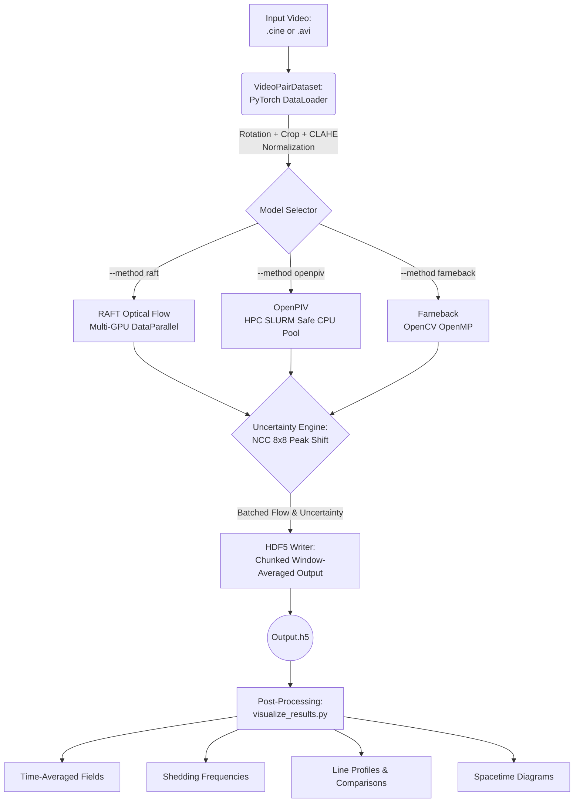

# Modular High-Speed PIV and Optical Flow Pipeline
## `velocimetry_for_multiphase`

This repository implements a high-speed, batch-processed Optical Flow and Particle Image Velocimetry (PIV) pipeline. It is specifically designed to handle large, uncompressed `.cine` and `.avi` files (up to tens of gigabytes), process them efficiently using GPU batching (RAFT) or CPU multi-processing (OpenPIV), and save the results dynamically to chunked HDF5 files to prevent memory exhaustion.

It estimates a per-pixel uncertainty alongside every flow field, flags where
that estimate is uninformative, and propagates both into time-averaged
statistics. Figure generation lives outside this repository; the tool writes
self-describing HDF5 for downstream analysis to read.

---

## Architecture Flowchart



---

## Installation

```bash
git clone https://github.com/ChNagaNitish/velocimetry_for_multiphase.git
cd velocimetry_for_multiphase
python3 -m venv .venv && source .venv/bin/activate
pip install -e ".[all]"     # or ".[cine]" / ".[piv]" for just what you need
pytest                      # confirm the install
```

RAFT weights are not bundled. Download a checkpoint into `weights/` and pass it
with `--model`.

---

## Quick start

```bash
python tracker.py \
  --path recording.cine \
  --method raft --model weights/raft-cloudcav.pth \
  --imgScale 0.0492 --fpsCam 130000
```

`--imgScale` (mm per pixel) and `--fpsCam` (Hz) are **required**: they cannot be
read from the video, and a wrong value scales every result you produce. Get the
scale from a calibration target imaged in the same optical configuration.


## 💡 Best Practices and Recommendations

For optimal tracking accuracy and significantly easier downstream analysis, we highly recommend perfectly aligning and cropping your flow geometry *before* running the optical flow tracking.

### 1. Rotate the Geometry Upfront
If your physics domain features tilted or sloped sections (such as a divergent wall angle), use the `--rotate_angle` parameter during tracking to physically level the image. 
* **Recommendation:** By supplying `--throat_loc Y X` alongside `--rotate_angle`, the pipeline will automatically use the throat as the center of rotation. Rotate the image until the divergent wall is perfectly horizontal.
* **Why?** Making the primary boundary horizontal drastically simplifies all subsequent post-processing. When extracting vertical flow profiles, plotting spacetime diagrams, or measuring cavity lengths along the wall, you won't need to apply complex spatial transformations to account for the angled geometry. Your primary downstream flow direction will perfectly align with the Cartesian X-axis, and your normal boundary layer with the Y-axis.

### 2. Set a Strict Region of Interest (ROI)
Always crop the raw cinematic files down to exactly the fluid domain of interest using the `--roi` argument.
* **Recommendation:** You can often take the whole width of the image, but you should usually limit it in the vertical axis to bound the active flow area and crop out the static walls/channels.
* **Why?** It prevents the tracking models (especially RAFT) from wasting computation on static background elements, metal blocks, or unused camera space. Keeping the ROI tightly bounding the fluid domain improves tracking focus, massively reduces overall processing time, and dramatically shrinks the exported `.h5` file sizes.

### 3. Use the CloudCav Model for RAFT
When using RAFT (`--method raft`) on fluid experiments, we highly recommend using the `raft-cloudcav.pth` weights instead of standard computer-vision weights.
* **Recommendation:** Pass `--model raft-cloudcav.pth` in your tracking commands for multiphase/fluid flows. (Ensure the weights file is downloaded to the `weights/` directory).
* **Why?** The `raft-cloudcav.pth` model has been explicitly fine-tuned on datasets specific to complex fluid dynamics and multiphase flows (such as cavitation, bubbles, and turbulent structures). It tracks deformable, fluid-like motion significantly better than baseline models trained purely on rigid-body tracking datasets (like Sintel or KITTI).

### 4. Prefer `.cine` over `.avi` Files
When exporting from your high-speed camera software, export directly to the uncompressed `.cine` format instead of `.avi` whenever storage permits.
* **Recommendation:** Supply `--path data/recording_1.cine` directly to the tracker instead of converting it to an AVI sequence.
* **Why?** `.cine` files retain the raw 12-bit (or 14-bit) dynamic range from the camera sensor, whereas `.avi` files are heavily compressed and downmixed to 8-bit space. The pipeline scales raw counts into the 0-255 range as *floating point*, so those extra levels survive preprocessing and reach the tracker rather than being rounded away.
* **Bit depth:** inferred from the data by default. Pass `--bit_depth 10|12|14` if your recording is unusual, or the scaling will be wrong.
* Whether the extra dynamic range measurably improves tracking on your setup is worth testing rather than assuming.

---

## 🚀 Running Velocimetry (Inference)

The main entry point for inference is `tracker.py`.

### 1. RAFT Optical Flow (Deep Learning, Single-GPU)
RAFT is the most accurate method. It requires a trained `.pth` weight file (placed in `./weights/`).

```bash
python tracker.py \
  --method raft \
  --model weights/raft-cloudcav.pth \
  --path data/recording_1.cine \
  --imgScale 0.0492 --fpsCam 130000 \
  --use_clahe
```

### 2. OpenPIV (Classical PIV, Multi-CPU)
OpenPIV runs on the CPU. It features an HPC-safe parallelization strategy that automatically detects your SLURM core allocation to prevent node oversubscription.

```bash
python tracker.py \
  --method openpiv \
  --path data/recording_1.avi \
  --imgScale 0.0492 --fpsCam 130000 \
  --use_clahe
```

### 3. Farneback (Classical Optical Flow)
Fast, baseline optical flow based on OpenCV's internal implementations.

```bash
python tracker.py \
  --method farneback \
  --path data/recording_1.cine \
  --imgScale 0.0492 --fpsCam 130000 \
  --use_clahe
```

### Common Inference Arguments

**Required**
- `--imgScale MM_PER_PX`: Image scale in mm per pixel, from a calibration target.
- `--fpsCam HZ`: Camera capture rate.

**Optional**
- `--frames N`: Only process the first `N` frames (useful for testing). Default `-1` (all).
- `--roi y1 y2 x1 x2`: Crop the video before processing. E.g., `--roi 0 -1 200 800`.
- `--use_clahe`: Apply Contrast Limited Adaptive Histogram Equalization to the video.
- `--win_h X --win_w Y`: Average the dense flow fields spatially into `X` by `Y` blocks before saving to HDF5. Default `4 4`.
- `--throat_loc y x`: Pass the pixel coordinates of the throat to save to metadata (required for some downstream post-processing).
- `--rotate_angle DEG`: Pre-rotate the image by `DEG` degrees (CCW) around `--throat_loc` before cropping. Useful for aligning sloped walls horizontally. Default `0.0`. Requires `--throat_loc`.
- `--bit_depth N`: Sensor bit depth for raw 16-bit input. Inferred if omitted.
- `--iters N`: RAFT GRU refinement iterations. Default `20`.
- `--uncert_window PX`: NCC window for the uncertainty estimate. Default `8`.
- `--uncert_search PX`: Half-width of the residual search. Defaults to `uncert_window // 2`. **Increase it when per-frame displacements are large**: residuals beyond this cannot be measured and are flagged invalid rather than reported.

---

## 📊 Post-Processing & Visualization

The `visualize_results.py` script bridges the `.h5` output with physical analysis. 

> **Prerequisite:** You must supply the original `--video` alongside the generated `--h5` for single-file analysis. The visualizer will automatically extract the `roi`, `rotate_angle` and `throat_loc_px` metadata saved during analysis, and correctly align, rotate, and crop the raw video frame before rendering the vector/contour overlays onto it.

### 1. Basic Inspections (Fields of View)

**Velocity & Uncertainty Contour Fields:**
Generates translucent heat-map overlays for either velocity magnitude or uncertainty mapping.

```bash
# Instantaneous Velocity Contour Video
python visualize_results.py \
  --video data/recording_1.cine \
  --h5 data/recording_1_raft.h5 \
  --contour

# Instantaneous Uncertainty Contour Video
python visualize_results.py \
  --video data/recording_1.cine \
  --h5 data/recording_1_raft.h5 \
  --contour \
  --dataset uncertainty \
  --alpha 0.6

# Time-Averaged Fields (Velocity & Reynolds Stresses images)
python visualize_results.py \
  --video data/recording_1.cine \
  --h5 data/recording_1_raft.h5 \
  --average
```

**Quiver Field (Vector Map):**
Overlays flow vectors onto the images, rigorously anchored to their respective physical spatial integration windows (e.g. 8x8 block centers).
```bash
# Generate a full .mp4 Quiver Video (Requires original video to match spatial dims)
python visualize_results.py \
  --video data/recording_1.cine \
  --h5 data/recording_1_raft.h5 \
  --quiver --quiver_skip 16 --quiver_scale 4.0

# Generate a single instantaneous high-res PNG Quiver Image (e.g. at Frame 100)
python visualize_results.py \
  --video data/recording_1.cine \
  --h5 data/recording_1_raft.h5 \
  --quiver --frame 100
```

**Animated U-Profile Overlay Video:**
Generates an MP4 video appending 10 equidistant instantaneous U-velocity profiles physically overlaid onto the flow.
```bash
python visualize_results.py \
  --video data/recording_1.cine \
  --h5 data/recording_1_raft.h5 \
  --profile_video \
  --fps 10
```

### 2. Multiphase Measurements

**Shedding Frequency (FFT):**
Calculates the shedding frequency using FFT over the spatially-averaged temporal V components.
```bash
python visualize_results.py \
  --video data/recording_1.cine \
  --h5 data/recording_1_raft.h5 \
  --frequency --plot
```

**Vapor Cavity Length:**
Tracks the bounding length of the phase/cavity over time, extracting the mean and standard deviations.
```bash
python visualize_results.py \
  --video data/recording_1.cine \
  --h5 data/recording_1_raft.h5 \
  --cavity --plot
```

**Spacetime Diagram:**
Creates a spacetime tracking diagram evaluated along the centerline of the flow.
```bash
python visualize_results.py \
  --video data/recording_1.cine \
  --h5 data/recording_1_raft.h5 \
  --spacetime
```

### 3. Spatial Line Extractions (Data Export)

To compare specific geometrical points, you can extract 1D lines of data mapped downstream of the `throat_loc`. By default, this will compute **time-averaged** profiles (U, V) and Reynolds Stresses (UU, VV, UV) over all frames.

If you specify a single `--frame N`, it will instead extract the **instantaneous velocity** profile for that specific snapshot without temporal averaging constraints.

```bash
# Extract profiles at 0mm, 1.5mm, 3mm, 5mm, 10mm, and 15mm downstream of throat X
python visualize_results.py \
  --video data/recording_1.cine \
  --h5 data/recording_1_raft.h5 \
  --profiles 0 1.5 3 5 10 15 \
  --frame 100
```
This generates a lighter-weight `_lines.h5` containing the profiles, their
uncertainties, and the calibration and provenance of the source file. Station
positions come from the `throat_loc_px` recorded at tracking time.

### 4. Making figures

Figure generation is deliberately **not** part of this repository. `tracker.py`
and `visualize_results.py` write self-describing HDF5; plotting scripts read it
and live wherever the analysis they belong to lives. The schema below is the
interface between the two, and it is versioned in `CHANGELOG.md`.

---

## 🗂️ Output format

`tracker.py` writes one HDF5 file per run:

| Dataset | Shape | Meaning |
|---|---|---|
| `velocity` | (T, Ny, Nx, 2) | pixel displacement per frame pair, (u, v) in image coordinates |
| `uncertainty` | (T, Ny, Nx, 2) | magnitude of the residual displacement error, pixels |
| `residual` | (T, Ny, Nx, 2) | **signed** residual error, pixels; `flow_corrected = flow - residual` |
| `valid_fraction` | (T, Ny, Nx) | fraction of the block where the estimate is informative, 0-1 |

Every dataset carries the full calibration and provenance as attributes
(`mm_per_px`, `fps_capture`, `roi`, `window_height`, `window_width`, `method`,
`model`, `n_frames`, `code_version`, and the CLAHE and uncertainty settings), so
any single dataset read in isolation is self-describing.

**Grid coordinates.** Block `(j, i)` covers source pixels
`[j*win_h, (j+1)*win_h) x [i*win_w, (i+1)*win_w)` and its centre sits at
`j*win_h + (win_h-1)/2`. Use `pipeline_utils.io.block_centers()` rather than
recomputing it.

**Validity.** The uncertainty estimator returns a number everywhere, including
where it has no information: decorrelated regions such as vapour cores, residual
errors larger than the search window, and reflection-padded frame borders. Those
points are flagged in `valid_fraction` and **must** be excluded from statistics.
`postprocess.velocity` does this; anything you write should too.

---

## 🎓 Running on VT ARC HPC Cluster (Falcon)

Since large multiphase videos (like `.cine` files) can take up hundreds of gigabytes, processing them on HPC clusters using the **SLURM workload manager** is highly recommended. The Virginia Tech ARC Falcon cluster features GPUs suitable for the RAFT machine learning algorithm.

### 1. Account and Allocation
1. The first step is to have an ARC account and get access to an Allocation through your Professor.
2. To see details of your ARC account, go to [coldfront.arc.vt.edu](https://coldfront.arc.vt.edu).
3. If you don’t see any allocations other than `Personal`, ask your professor to provide one. Most likely it will be `Cavitation`.

### 2. Accessing the Terminal and Loading Modules
After you get the ARC account running, visit [ood.arc.vt.edu](https://ood.arc.vt.edu) to access the clusters and data. 
We can access the linux terminal through **ood.arc.vt.edu -> Clusters -> Falcon Shell Access**. The Linux Terminal will open in a new window.

Before algorithm execution, we must configure a Python environment. First, load the explicitly required Python and CUDA modules:
```bash
module load Python/3.12.3-GCCcore-13.3.0 CUDA/12.6.0
```

### 3. Setting Up Your Python Environment
In the terminal, type the following command to create a virtual environment (you can choose your own name):
```bash
python3 -m venv NAME-OF-THE-ENV
```

Activate the environment for this terminal session:
```bash
source ~/NAME-OF-THE-ENV/bin/activate
```

Install the required packages strictly after activation:
```bash
pip3 install -e ".[all]"
```

### 4. Cloning the Repository
After all the prerequisites are met, we can run the code. If not done before, create an account on GitHub and fork the repository (or directly clone it):
```bash
git clone https://github.com/ChNagaNitish/velocimetry_for_multiphase.git
cd optical-flow-cloud-cavitation
```

### 5. SLURM Submission Script (`jobScript.sh`)
You cannot directly run the heavy PyTorch/Optical Flow scripts on ARC login nodes. You must use SLURM to create a job and submit it to the queue, specifying required resources (like GPUs).

Save the following block as `jobScript.sh`. You might have to run `chmod +x jobScript.sh` to make it executable.

```bash
#!/bin/bash
# 
#SBATCH -t 0-02:00:00 
#SBATCH -N 1
#SBATCH --ntasks-per-node=1
#SBATCH --cpus-per-task=16
#SBATCH --account=cavitation 
#SBATCH --partition=a30_normal_q 
#SBATCH --gres=gpu:1 
#SBATCH --mail-user=your-email@vt.edu 
#SBATCH --mail-type=ALL 
#SBATCH --job-name=raft48 
 
# Loading required modules 
module purge 
module reset 
module load GCC/13.3.0 Python/3.12.3-GCCcore-13.3.0 
module load CUDA/12.6.0 

# Activate environment
source "$HOME/NAME-OF-THE-ENV/bin/activate" 

# Run the algorithm
python3 tracker.py --method raft --model weights/raft-cloudcav.pth \
  --path /home/your-pid/experiment/48.avi \
  --imgScale 0.0492 --fpsCam 130000
```
*Note: This script asks for 1 GPU using the "cavitation" account and "a30_normal_q" partition for 2 hours.*

Submit the job to the cluster scheduler using:
```bash
sbatch jobScript.sh
```
*You can check your job status by using `squeue -u <Your-PID>` to see whether it is running or still in the queue.*

---

## 🗃️ Data Transfer via SFTP

Secure File Transfer Protocol (`sftp`) creates a secure connection to transfer files (like your processed `.h5` results or plots) between your local machine (e.g., your laptop or Windows Subsystem for Linux (WSL)) and the ARC HPC clusters. *More details can be found at [docs.arc.vt.edu](https://docs.arc.vt.edu/usage/data_transfer.html).*

### 1. Establishing the Connection 
Open your **local** terminal and run the following command. You will likely be prompted for your password and 2-factor authentication (Duo). 
```bash
sftp your-PID@datatransfer.arc.vt.edu
```
*Note: When you are successful, your command prompt will change to `sftp>`.*

### 2. Navigation
SFTP allows you to navigate two filesystems simultaneously. Standard commands affect the Remote system (ARC), and commands prefixed with **`l`** (for "local") affect your Local machine.

| Action | Remote Command (ARC) | Local Command (Your PC) |
|---|---|---|
| List Files | `ls` | `lls` |
| Print Working Directory | `pwd` | `lpwd` |
| Change Directory | `cd directory_name` | `lcd directory_name` |
| Make Directory | `mkdir new_folder` | `lmkdir new_folder` |

**Examples:**
Check where you are: 
```bash
pwd   # Shows path on ARC (e.g., /home/your-PID/) 
lpwd  # Shows path on local machine (e.g., /mnt/c/Users/You/Documents)
```
If you are using Windows Subsystem for Linux (WSL), you can access your Windows drives via the `/mnt/` mount point:
```bash
lcd /mnt/c/Users/YourName/Desktop
```

### 3. Transferring Files
The core commands are `get` (download from ARC) and `put` (upload to ARC).

**Downloading (ARC $\rightarrow$ Local):**
```bash
get filename.txt                   # Single File
get -r RemoteDirectoryName         # Entire Directory (recursive)
```

**Uploading (Local $\rightarrow$ ARC):**
```bash
put data_file.csv                  # Single File
put -r LocalDirectoryName          # Entire Directory (recursive)
```

### 4. File Management & Exiting 
You can perform basic file management without leaving the SFTP session:
- **Rename a remote file:** `rename old_name new_name` 
- **Delete a remote file:** `rm filename` *(Warning: there is no "trash bin" in CLI)* 
- **Delete a remote directory:** `rmdir directory_name` 
- **Exit the session:** Type `exit`, `bye`, or `quit` to return to your standard shell.

---

## 📐 Appendix A: Uncertainty Quantification

### A.1 What is measured

After the tracker predicts a displacement field, frame 2 is backward-warped onto
frame 1. In a perfect measurement the warped frame matches frame 1 exactly. A
local window of integer pixel shifts is searched for the peak of the Normalized
Cross-Correlation surface, and a 3-point Gaussian fit locates that peak to
sub-pixel precision. The offset between the peak and zero shift is the
**residual displacement error**:

$$ \delta = \frac{\ln R_{-1} - \ln R_{+1}}{2(\ln R_{-1} + \ln R_{+1} - 2\ln R_0)} $$

This is a *signed, per-frame realised error*, not a standard deviation, and the
distinction matters: part of it is systematic. A tracker's smoothness prior
under-predicts the same velocity gradient in the same place every frame, and
that component does not average away. The sign is therefore preserved
(`flow_corrected = flow - residual`), and the two components are separated at
averaging time:

$$ \delta(t) = b + \epsilon(t), \qquad b = \overline{\delta}, \qquad \mathrm{Var}(\epsilon) = \sigma_{\text{rand}}^2 $$

### A.2 Where the estimate is invalid

The correlation surface is uninformative in three situations, all flagged in
`valid_fraction` rather than reported as a confident number:

- the peak lies on the edge of the search window, so the true residual is larger
  than can be measured — widen `--uncert_search` if this is common;
- the peak correlation is too weak to locate, or the surface is not locally
  convex;
- the point lies within `search + window` of the frame border, where reflection
  padding manufactures correlation and biases the estimate low.

### A.3 Propagation to time averages

**Mean velocity.** Bias survives averaging; random error shrinks with the
*effective* sample count, because successive frames of an unsteady flow are
correlated:

$$ \sigma_{\bar{u}} = \sqrt{ b^2 + \frac{\sigma_{\text{rand}}^2}{N_{\text{eff}}} }, \qquad N_{\text{eff}} = \frac{N}{2\tau_{\text{int}}} $$

with the integral timescale $\tau_{\text{int}}$ measured from the velocity
autocorrelation (Benedict & Gould, *Exp. Fluids* 22, 1996). The instantaneous
measurement precision, $\sqrt{\overline{\sigma^2}}$, is reported separately as
`instantaneous_precision`: it answers a different question — how well a single
frame is resolved — and does not shrink with record length.

**Reynolds stresses.** Random error *inflates* a measured variance, so the noise
floor is subtracted:

$$ \langle u'u' \rangle_{\text{corrected}} = \langle u'u' \rangle_{\text{measured}} - \sigma_{\text{rand}}^2 $$

Both corrected and uncorrected values are stored. The uncertainty of the stress
follows the delta method, with $\partial R/\partial u_k = (2/N)(u_k - \bar{u})$:

$$ \sigma_{\langle u'u' \rangle} = \frac{2}{N} \sqrt{ \sum_t (u(t)-\bar{u})^2 \sigma_u^2(t) } $$

$$ \sigma_{\langle u'v' \rangle} = \frac{1}{N} \sqrt{ \sum_t \left[ (v(t)-\bar{v})^2 \sigma_u^2(t) + (u(t)-\bar{u})^2 \sigma_v^2(t) \right] } $$

Note the $1/N$ *outside* the square root, i.e. $1/N^2$ on the variance. These
are verified in `tests/test_statistics.py` against the scatter the estimators
actually exhibit under repeated noise realisations, rather than against the
formulas themselves.

### A.4 Limitations

- **Not yet validated against ground truth.** A coverage test on synthetic pairs
  with known flow — does a ±1σ band contain the true error 68% of the time? — is
  the next step. Until then, treat σ as an indicator rather than a calibrated
  interval.
- **Matching error only.** The budget excludes calibration uncertainty in
  `mm_per_px` (which enters velocity linearly and stresses quadratically),
  timing, out-of-plane motion, and the tracker's own smoothness prior beyond
  what the residual captures.
- **The shear-stress formula assumes independent u and v errors.** A
  mis-registration displaces both components together, so a cross-term is
  missing.
- **Errors are assumed independent between neighbouring pixels within a block.**
  The block average of σ treats them as fully correlated instead, which is the
  conservative choice given overlapping NCC windows.
